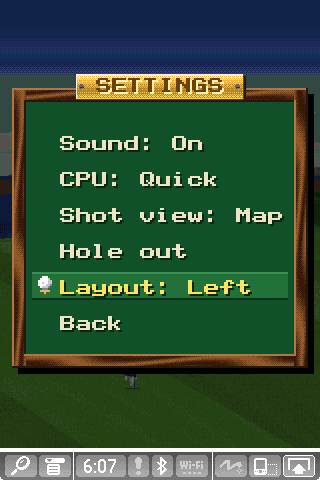
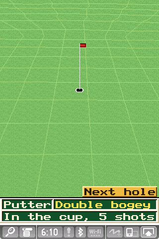
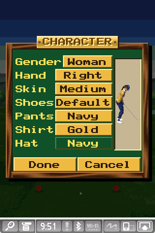
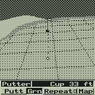
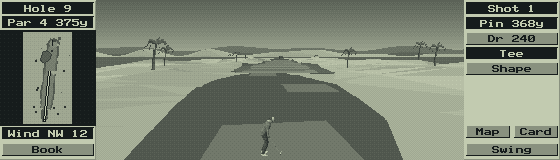
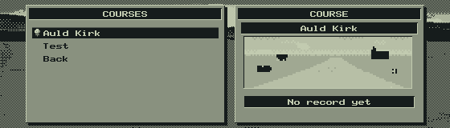

# Par 386

Par 386 is a golf game for Palm OS in the style of early ’90s PC golf games. Pick a club, aim down the fairway and time a three-click swing. Follow the ball in the 3D view or on the overhead map, then read the slope on the green and putt out.

Play nine courses, take turns with up to four players on one Palm, or play against computer golfers. There are two-round tournaments, a driving range and a practice green. Leave a round and pick it up again from the clubhouse.

Enjoy, 
Dan

Puffin Ledge at Carrig Head, from the title screen to the cup. The waits are shortened.

## Screenshots

<table>
  <tr>
    <td align="center"> Title</td>
    <td align="center"> Left-handed portrait layout on the TX</td>
  </tr>
  <tr>
    <td align="center"> Ball flight</td>
    <td align="center"> Putting at Carrig Head on the TX</td>
  </tr>
  <tr>
    <td align="center"> Layout setting on the TX</td>
    <td align="center"> Hole complete</td>
  </tr>
  <tr>
    <td align="center"> Character editor on the TX</td>
    <td align="center"> Putting on the IIIx</td>
  </tr>
</table>

<table>
  <tr>
    <td align="center"> Saffron Dunes tee on AlphaSmart Dana</td>
  </tr>
  <tr>
    <td align="center"> AlphaSmart Dana course picker</td>
  </tr>
</table>

The TX demo and round pictures are from 0.12.0. The character editor, IIIx and Dana pictures are from 0.11.0. All were captured in [Frond](https://github.com/roge-rm/frond).

## Install

[Download Par 386](https://github.com/roge-rm/par386/releases/latest). HotSync one PRC and at least one course PDB.

| ZIP | Palm OS | App size | Size per course |
|---|---|---:|---:|
| `Par386-0.13.0.zip` | 3.1 or newer | 1.3 MB | 1.3 to 1.8 MB |
| `Par386-small-0.13.0.zip` | 3.0 or newer | 516 KiB | 672 to 905 KiB |

Both ZIPs have Auld Kirk, Banksia Heath, Bracken Mere, Carrig Head, Cascade Springs, Crocodile Bend, Falesia Grove, Saffron Dunes and Sakura Bay. Compact courses work with either app. Install one version of each course. The picker holds up to 12.

If you see **Update course**, install the current PDB. Each hole needs a terrain mesh and putting contours. The bundled courses also have lie grids for quicker loading.

### SD cards

Copy course PDBs to `/PALM/Programs/Par386/`, `/PALM/Launcher/` or the root of the card. Leave room in handheld memory for the whole course.

On a Palm m125, put `Par386.prc` in `/PALM/Launcher/` on a FAT16 card. Open it from the card category. Leave room in handheld memory for the app.

If a large partition gives you **Can't Copy**, install the [Palm File Manager Update](https://palmdb.net/app/palm-file-manager-update) in handheld memory and run **SD Installer**. A 32 MiB FAT16 partition worked in Frond with an unpatched m125.

## Devices

- The regular app supports 1-bit monochrome, 2-bit and 4-bit greyscale, and 8-bit and 16-bit colour. The Carrig Head title and menus fill tall and landscape colour screens.
- The small app is for 160×160 monochrome and greyscale screens. Tested on the Palm III with Palm OS 3.0 in CloudpilotEmu.
- The regular app was tested in Frond on the Palm IIIx, Tungsten TX, Zire 72, Sony CLIÉ and AlphaSmart Dana.

Older Palms and the small app play tones. The regular app plays samples for the strike, landing, splash and cup on Palm OS 5 devices with sound streams. **Settings → Sound** has **On**, **Effects** and **Off**.

Putting contours work on all displays. 68k Palms use compact meshes. On the TX, the regular app uses ARM code for detailed meshes and colour conversion.

On the Dana (560×160), tap the side map to aim and follow the ball there. **Map** opens a larger view. The course picker puts the preview beside the list. Round setup puts players beside the tee and hole choices. The 18-hole card shows both nines.

In landscape, the bottom bar also shows hazards or round standings. The swing meter uses the full width.

## Playing

1. Pick a course under **Courses**. Choose **Play a round**.
2. Pick a game and set the player slots. Choose **Tee off**.
3. Tap the view to aim. The aim mark fades after a moment. Tap the club to change it.
4. Tap **Swing**, tap again for power, then tap as the marker comes back to the snap line. An early or late snap sends the shot off line.
5. On the green, tap **Putt**, then tap again for power. The cup mark accounts for green speed and slope.

On standard layouts, **Settings → Shot view** switches between the map and 3D view during shots.

The game saves when you leave a round. Pick **Continue round** to carry on.

In **Player**, set a name of up to eight characters for the first human player. **Aa** switches case. **Edit Character** changes their gender, handedness, skin colour and clothes. The preview updates as you make changes.

## Games and practice

Set each slot to Human, a computer golfer (**Easy**, **Fair**, **Good** or **Pro**) or **Off**. The computer makes more mistakes on lower levels. **CPU: Quick** shows where the shot ended. **CPU: Full** shows the whole shot. Tap or press any key to skip ahead.

On an 18-hole course, **Holes** offers **All 18**, **Front 9** and **Back 9**. Each tee and hole set has its own record. Tournaments use the whole course.

| Game | Players | Scoring |
|---|---|---|
| Stroke play | 1 to 4 | Fewest strokes |
| Match play | 2 | Win, lose or halve each hole. A lead greater than the holes left ends the match (3 & 2, for example) |
| Skins | 2 to 4 | The lowest score wins the skin. A tie carries it to the next hole |
| Best ball | 4 | P1 and P2 play P3 and P4. Use each side's better score |
| Tournament | 1 to 4 | Two rounds of stroke play against eight computer golfers. The card and hole result show the running total. Setup shows your best finish after two rounds |

**Gimmies: 2 ft** gives short putts and counts the stroke. **Hole out** makes you play them. This applies to new rounds.

The driving range starts each ball on the first par 5 tee. Putting practice moves the ball around the first green. Toggle **Repeat** with the pen or Scorecard button to stay in one spot.

**Courses** shows your best score under the course picture. The game keeps up to 36 course, tee and hole-set records from human rounds. A new record replaces the oldest when the list is full.

On the final card, **Stats** or Scorecard shows fairways hit, greens in regulation, putts and penalties. **Next** shows the other players. Gimmies count as putts.

## Controls

**Settings → Layout** puts Swing and Putt on the left or right. On the Dana, it swaps the map and controls.

The game uses the four app buttons during play. Press Home (Applications) to leave.

**Shape** resets after each shot. Draw, fade, high and low work with any club except the putter. Punch starts at the 3 iron, open at the 9 iron.

### Palm IIIx and other Palms with app buttons

| Button | What it does |
|---|---|
| Date Book (1st app button) | Start swing, power, snap. Select in menus |
| Address (2nd) | Map, and back |
| To Do (3rd) | Scorecard, and back |
| Memo (4th) | Next shot shape |
| Scroll up and down | Change club, move in menus |
| Menu | Back to the clubhouse |

### 5-way (Tungsten, Zire 72, Treo and the like)

| Key | What it does |
|---|---|
| Left and right | Aim |
| Up and down | Change club |
| Centre | Start swing, power, snap |
| App buttons | 2nd Map, 3rd Scorecard, 4th Shape |

On the map, Left and Right move the target in 5° steps. Up opens **Book**. The arrow shows which way the wind is blowing. Centre or Map goes back to the scene.

### Sony CLIÉ Jog Dial

| Control | What it does |
|---|---|
| Turn up and down | Change club, move in menus |
| Press | Start swing, power, snap |
| Back | Back to the clubhouse |
| App buttons | As on the IIIx |

### Pen

| Tap | What it does |
|---|---|
| Club | Open the club picker. On the green, only the putter is available |
| Shape | Next shot shape |
| Map | Tap a target to aim and see the yardage. **Near** zooms in. **Hole** zooms out. **Back** keeps the target |
| Book (on the map) | Yards to the near and far edges of hazards on your line. A `+` means there's no far edge shown |
| Card (on the map) | Scorecard |

On the Dana, Left and Right aim. Up and Down change clubs. Enter swings or selects. C or S opens the scorecard. Other letters open the map. Backspace goes back to the clubhouse.

## Building

Install prc-tools-remix, `arm-palmos-gcc` and PilRC. Put the Palm OS SDK 5r3 at `../palm-os-sdk/sdk-5r3`. You also need Python 3, Pillow and NumPy.

- `make release` builds `build/Par386.prc` and the course files. The debug build currently exceeds the Palm code segment limit.
- `make small compact-courses` builds `build/Par386-small.prc` and the PDBs in `build/compact-courses/`.
- `make host-test` builds and tests the game core with GCC, ASan and UBSan.
- `make courses` compiles the courses into `build/courses/`. See the [course format](doc/course-format.md) to make your own.

## Licence

[GPLv3](LICENSE).

The golfer’s swing uses data from the [CMU Motion Capture Database](https://mocap.cs.cmu.edu/), funded by NSF EIA-0196217. See the [golfer asset credits](tools/golfer/ASSETS.md).
