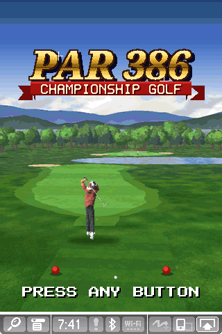
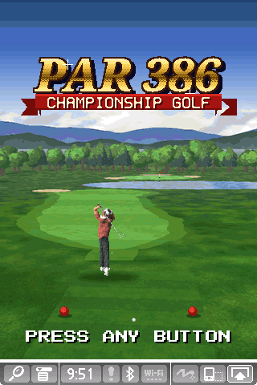
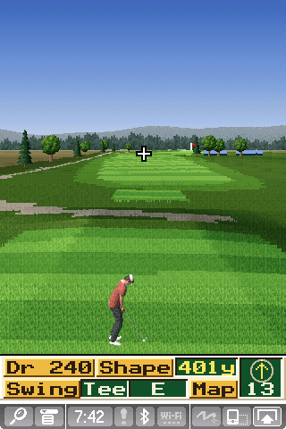
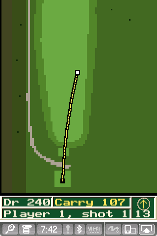
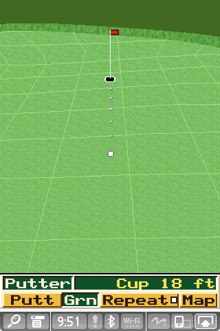

# Par 386

Par 386 is a golf game for Palm OS in the style of early ’90s PC golf games. Pick a club, aim down the fairway and time a three-click swing. Follow the ball on the overhead map, then read the slope on the green and putt out.

Play nine courses, take turns with up to four players on one Palm, or play against computer golfers. There are two-round tournaments, a driving range and a practice green. Leave a round and pick it up again from the clubhouse.

Enjoy, 
Dan

## Screenshots

<table>
  <tr>
    <td align="center"> Title</td>
    <td align="center"> On the tee</td>
  </tr>
  <tr>
    <td align="center"> Ball flight</td>
    <td align="center"> Practice green</td>
  </tr>
</table>

<table>
  <tr>
    <td align="center"> AlphaSmart Dana tee view</td>
  </tr>
  <tr>
    <td align="center"> AlphaSmart Dana course picker</td>
  </tr>
</table>

Captured on a Tungsten TX and an AlphaSmart Dana in the [Frond emulator](https://github.com/roge-rm/frond).

## Devices

One build runs on Palm OS 3.1 and up, from a Palm IIIx in greys to a Tungsten TX in colour. The title and menus fill the available display on supported tall and landscape colour screens. Older Palms play tones. Palm OS 5 devices with sound streams also play sampled strikes, landings, splashes and cup sounds. Settings offers On, Effects and Off.

On the AlphaSmart Dana, the 560×160 layout shows the course between a small hole map and the shot controls. Tap the small map to aim, or open **Map** for a larger view from tee to green. The ball trail stays visible in the small map during the shot. The course picker shows the preview beside the list, round setup puts players beside the tee and hole options, and an 18-hole scorecard shows both nines together.

Standard landscape puts the hole and shot details in the bottom bar, which becomes a full-width meter during the swing.

Frond checks have covered the IIIx, TX, Zire 72, Sony Clié models and the Dana. Physical-device checks are tracked in the [handoff](HANDOFF.md#before-the-next-release).

## Install

Download `Par386-0.9.0.zip` from the [0.9.0 release](https://github.com/roge-rm/par386/releases/tag/v0.9.0). Install `Par386.prc` and at least one course file (`Par386-*.pdb`) with HotSync. If you already have the courses, you can update with the standalone PRC. You can also copy course files to an SD card in `/PALM/Programs/Par386/`, `/PALM/Launcher/` or the root of the card. A card course is copied into Palm memory while you play it, so leave about 70 KB free.

The nine courses are Auld Kirk, Banksia Heath, Bracken Mere, Carrig Head, Cascade Springs, Crocodile Bend, Falesia Grove, Saffron Dunes and Sakura Bay. You can have up to 12 courses in the picker.

## Playing

Pick a course under **Courses**, then choose **Play a round**. Pick a game, set the player slots and choose **Tee off**. Par 386 picks a club for the distance. Tap the club to change it, tap the view to aim, or open **Map** and tap a target to check its yardage. **Book** shows approximate distances to hazards along that line.

Tap **Swing** to start the meter. Tap again to set power, then tap as the marker comes back to the snap line. An early or late snap sends the shot off line. On the green, tap **Putt** to start and tap once more to set power. The cup mark on the meter allows for green speed and slope.

Leaving the round saves it. Choose **Continue round** in the clubhouse to carry on. Under **Player**, you can set the first human player’s name (up to eight characters), golfer, skin colour and handedness.

## Games and practice

Set each player slot to Human, a computer golfer (Easy, Fair, Good or Pro), or Off. On an 18-hole course, **Holes** lets you play All 18, Front 9 or Back 9. Each set has its own record for each tee. Tournaments use the full course.

| Game | Players | How it's scored |
|---|---|---|
| Stroke play | 1 to 4 | Fewest strokes |
| Match play | 2 | Each hole won, lost or halved; the match ends once one side is more holes up than there are left, as "3 & 2" |
| Skins | 2 to 4 | The lowest score alone wins the hole's skin; a tie carries it to the next hole |
| Best ball | 4 | P1 and P2 against P3 and P4, a match on each side's better score |
| Tournament | 1 to 4 | Two rounds of stroke play against eight computer golfers. The leaderboard shows the running total after each hole and from the card. The event setup shows your best finish on that course once you've played both rounds. |

The panel's middle box shows how you stand: holes up or down in match play and best ball, the skins carried over in skins, and your score to par otherwise.

Computer golfers aim, pick a club and shot shape and swing through the same physics as you, with more error the lower their level. In Settings, CPU: Quick shows only where their shot finished on the map, and CPU: Full shows the whole shot. A tap or any key hurries them on.

In Settings, Gimmies: 2 ft gives short putts and counts the stroke. Choose Hole out to play them. The setting applies when you start a new round.

Practice has a driving range (the first par 5, each ball from the tee) and a putting green (a ball somewhere on the first green each time you hole out). On the practice green, tick Repeat to putt from the same spot each time. Tap it again to return to new spots. The Scorecard button also toggles Repeat.

Your best score on each course shows under its picture on the Courses board. Only rounds played through by a person count. The game keeps up to 36 course, tee and hole-set records. Once the list is full, a new record replaces the oldest entry.

On the final card, tap Stats or press Scorecard to see fairways hit, greens in regulation, putts and penalties. Use Next to see the other players' stats. Gimmies count as putts.

## Controls

While you play, the four app buttons belong to the game, so they don't open Date Book and the rest. To leave, use the Home (Applications) button.

The shot shape goes back to Shape (a normal shot) after every shot. Draw, fade, high and low work with any club but the putter, punch from the 3 iron down and open from the 9 iron down.

Palm IIIx and other Palms with app buttons:

| Button | What it does |
|---|---|
| Date Book (1st app button) | Swing: start, power, snap. Select in menus |
| Address (2nd) | Map, and back |
| To Do (3rd) | Scorecard, and back |
| Memo (4th) | Next shot shape |
| Scroll up and down | Change club, move in menus |
| Menu | Back to the clubhouse |

5-way (Tungsten, Zire 72, Treo and the like):

| Key | What it does |
|---|---|
| Left and right | Aim |
| Up and down | Change club |
| Centre | Swing: start, power, snap |
| App buttons | As on the IIIx: 2nd map, 3rd scorecard, 4th shot shape |

On the map, left and right move the target in 5° steps. Up opens the yardage book. The wind arrow points the way the wind blows across the map. Centre or the Map button goes back to the scene.

Clie Jog Dial:

| Control | What it does |
|---|---|
| Turn up and down | Change club, move in menus |
| Press | Swing: start, power, snap |
| Back | Back to the clubhouse |
| App buttons | As on the IIIx |

Pen, on any device:

| Tap | What it does |
|---|---|
| The view | Aim there |
| Swing or Putt | Start the meter. Tap again for power and, on a swing, snap |
| The club on the panel | Open the club picker. On the green, only the putter is available |
| Shape on the panel | Next shot shape |
| Map on the panel | Tap a spot to aim there and see its yardage. Back returns to the scene with the target marked |
| Book on the map's panel | Approximate near and far yardages from the ball to hazards along your aim. A `+` means no far edge is shown |
| Card on the map's panel | Scorecard |

On the Dana keyboard, use Left and Right to aim, Up and Down to change clubs, and Enter to swing or select. C or S opens the scorecard, Backspace goes back to the clubhouse, and other letters open the map.

## Building

You need prc-tools-remix, `arm-palmos-gcc`, PilRC, the Palm OS SDK 5r3 at `../palm-os-sdk/sdk-5r3`, and Python 3 with Pillow and NumPy.

- `make` builds a debug `build/Par386.prc` and the course files.
- `make release` builds the release PRC and the course files.
- `make host-test` builds and tests the game core with GCC, ASan and UBSan.
- `make courses` compiles the courses into `build/courses/`. See the [course format](doc/course-format.md) to make your own.

See the [plan](PLAN.md) for development milestones.

## Licence

[GPLv3](LICENSE).

The golfer’s swing uses data from the [CMU Motion Capture Database](https://mocap.cs.cmu.edu/), funded by NSF EIA-0196217. See the [golfer asset credits](tools/golfer/ASSETS.md).
